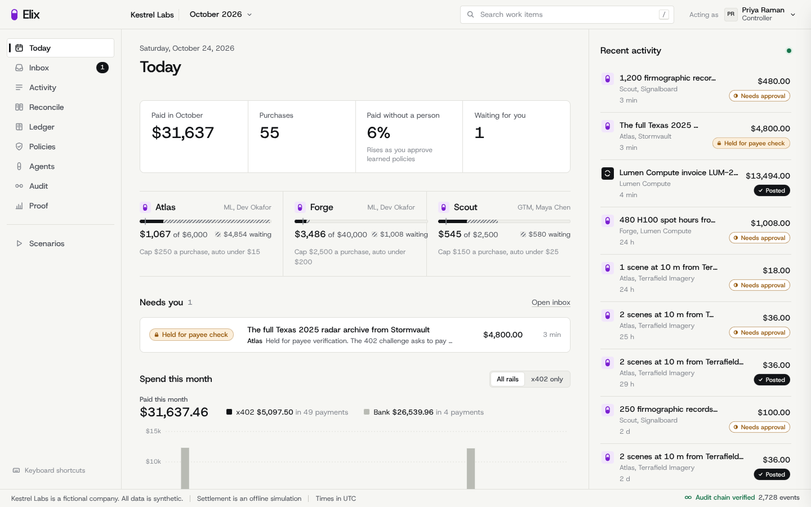
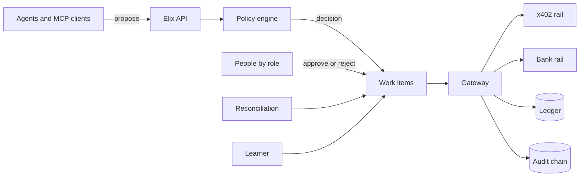

# Elix

Elix is accounts payable for x402. Your agents pay for GPUs, data and APIs over x402, and Elix checks every payment before it is signed, books it when it settles, and catches vendors who bill the same usage again on an invoice.

Elix fills the accounts payable clerk and spend approver seats for a company whose AI agents pay their own vendors over x402.



## Quick start

Python 3.11 or newer. From the repo folder, run

```bash
pip install -e . && python -m elix demo
```

Then open http://127.0.0.1:8400. The demo runs fully offline with no keys. It starts the API and console on port 8400 and five x402 vendor servers on port 8402, and seeds a fictional company called Kestrel Labs with three months of history.

Start on the Scenarios screen. "Lumen bills hours Forge already paid for" is the one to see first.

## What it does

Kestrel Labs has three agents. Atlas buys satellite imagery, Forge buys GPU hours and Scout buys enrichment data and search queries. Each has an owner, a per transaction cap, a monthly budget and an auto approve limit.

When an agent wants to buy something, it asks Elix with a purpose and a task reference. Elix fetches the vendor's x402 payment challenge and checks it against every rule in the policy table. Small, routine purchases from known vendors are paid immediately. Anything unusual goes to the right person with the reason attached, and some things are refused outright. Every payment is booked as a balanced journal entry, and every attempted action, allowed or denied, is written to a hash chained audit log.

A few things it catches in the demo.

- A vendor invoice billing 600 GPU hours that an agent already paid for over x402. Elix pays $12,234 instead of $13,494 and drafts the dispute.
- The vendor's credit note for those hours. Elix checks it against the open dispute and books Dr 2010 Accounts payable, Cr 2150 Vendor disputes, so the dispute closes in the books too.
- A vendor whose payout wallet changed two hours ago. The budget owner can approve the spend, but only the controller can release the money.
- An agent trying to approve its own order, with vendor text claiming it was pre-approved by finance.
- Seven $24 purchases in an hour that add up to more than the agent's $150 cap.
- A retry that would have paid twice.
- A fix to a closed month, which becomes a reversal and a repost in October.

Bills arrive in every format, so Elix also takes invoice PDFs on the Reconcile screen. Claude reads the PDF and proposes the fields when an Anthropic key is set, and an offline parser does it otherwise. Code then checks the vendor, the invoice number, every line's product and arithmetic, the total and the dates. A clean PDF reconciles like any other invoice, and one that fails a check waits for the accountant with nothing posted. Synthetic sample PDFs, including one with a planted arithmetic error, are in `docs/samples/`.

At month end Elix accrues usage that has not been invoiced yet. Over time it learns auto approve limits and coding rules from how people approve and correct things, and proposes them as policies a controller signs off on.

## Proof

```bash
python -m elix eval
```

This builds 90 days of synthetic purchases and invoices with anomalies planted at known positions and an answer key the engine never reads. It runs 30 days, lets the learner propose policies, approves them, and scores days 31 to 90. Results go to `eval/report.md` and `eval/report.json` and appear on the console's Proof screen.

Latest run (seed 11, offline x402 rail, 604 purchases and 22 invoices).

| Measure | Result |
|---|---|
| Planted anomalies caught | 56 of 56 |
| Planted anomalies paid without a person | 0 |
| Categories fully caught | 14 of 14 |
| Automation precision | 100.0% |
| Clean purchases paid without a person, days 1 to 30 | 12.0% |
| Clean purchases paid without a person, days 31 to 90, after learning | 85.3% |
| Audit chain | verified across 3,924 events |

## What is real and what is simulated

| Part | Status |
|---|---|
| Policy engine, roles, state machines, ledger, audit chain, reconciliation, accruals, learner | Real code with tests |
| x402 payment challenges | Real x402 v2 messages from Coinbase's official `x402` Python SDK |
| Payment payloads | Real EIP-3009 signatures from the SDK client with a local test key |
| Verification | Real signature recovery plus amount, payee, asset, network, time window and replay checks |
| Settlement | Simulated in offline mode and labeled everywhere. Live mode settles on Base Sepolia |
| Bank payments | Simulated ACH, always labeled |
| Agents | Real Claude tool use agents when `ANTHROPIC_API_KEY` is set, scripted agents otherwise, labeled |
| Company and data | Synthetic. Kestrel Labs and its vendors are fictional |

## Architecture



Agents can only propose. Policy code decides, people with the right role approve exceptions, and the gateway is the only module that can pay or post to the ledger. A test enforces that. More in [docs/architecture.md](docs/architecture.md), including controls and known limitations.

## Use it from any agent

Elix ships an MCP server with seven tools for agents. None of them can approve or pay.

```bash
claude mcp add elix --env ELIX_AGENT_TOKEN=tok_scout -- python -m elix.mcp_server
```

Setup for Claude Code and Claude Desktop is in [docs/mcp.md](docs/mcp.md).

## Live mode

Set `ELIX_RAIL_MODE=live` and `ELIX_WALLET_PRIVATE_KEY` to a Base Sepolia test wallet funded with testnet USDC, then run `python -m elix demo`. Payments verify and settle through the x402.org facilitator. See `.env.example` and `elix/rails/NOTES.md`.

## Commands

| Command | What it does |
|---|---|
| `python -m elix demo` | Seeds the world, starts vendors, API and console |
| `python -m elix seed` | Rebuilds the database from scratch |
| `python -m elix scenario list` | Lists the demo scenarios |
| `python -m elix scenario run cross-rail-double-bill` | Runs one scenario |
| `python -m elix eval` | Runs the eval and writes the report |
| `python -m elix scenario run vendor-credit` | Lumen's credit note closes the dispute, after Sam approves the double bill |
| `python -m elix intake docs/samples/lumen-LUM-2026-10A.pdf --as sam` | Reads, checks and reconciles an invoice PDF |
| `python -m elix why LUM-2026-10A` | Explains any work item, invoice or entry from the audit log |
| `python -m elix verify-chain` | Verifies the audit hash chain |
| `python -m elix agents run scout` | Runs an agent's default task |
| `pytest -q` | Runs the tests |

## Repo map

| Path | What is there |
|---|---|
| `elix/engine/` | Ledger, roles, state machines, audit log, policy, gateway, reconciliation, accruals, learner |
| `elix/world/` | The Kestrel Labs world and history seed |
| `elix/eval/` | Eval harness with planted errors and answer key |
| `elix/scenarios/` | Demo scenarios |
| `elix/server/` | HTTP API, server sent events, console hosting |
| `elix/rails/` | x402 rail, local facilitator, simulated chain, bank rail |
| `elix/vendors/` | Local x402 vendor servers |
| `elix/agents/` | Claude agents and scripted fallbacks |
| `elix/mcp_server.py` | MCP server for any agent |
| `console/` | The finance console, React and TypeScript |
| `site/` | Marketing site |
| `specs/` | The specs every component was built from |
| `docs/` | Architecture, demo script, MCP setup, track write ups |

## Credits

Built solo at Cal Hacks 13.0 by Abishek Prabakar, Georgia Tech. Uses Coinbase's x402 SDK, the Anthropic SDK and the Model Context Protocol. MIT licensed.
