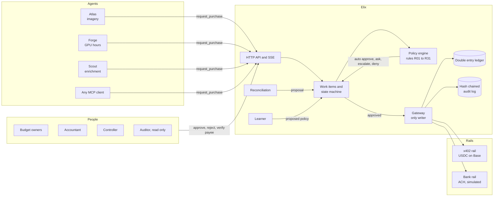
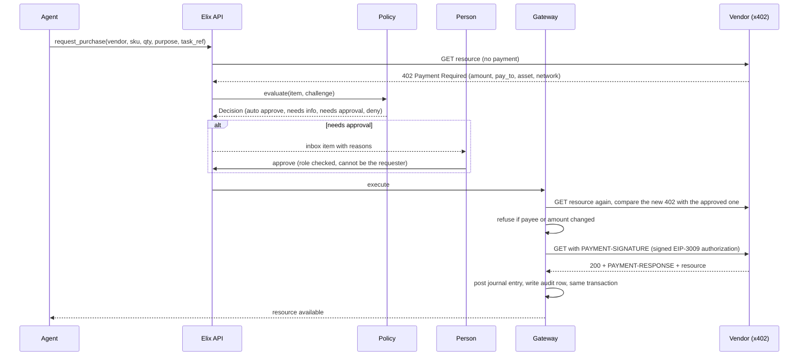

# Architecture

Elix sits between a company's AI agents and every way they can pay. Agents propose purchases. Elix decides, asks a person when it should, pays through the right rail, books the journal entry and writes down why. The design rule is simple. Language models may propose and explain. Only deterministic code authorizes, only people with the right role approve exceptions, and only the gateway can move money or write to the ledger.

## Components

The engine lives in `elix/engine/`. Every public operation goes through one facade, `Elix`, so the console, the CLI, the MCP server and tests all use the same code path. The HTTP server in `elix/server/` is a thin layer over that facade.

| Module | What it does |
|---|---|
| `permissions` | Roles map of actors, actions and resources. `can()` checks role and the four segregation rules. |
| `workflow` | State machines for purchases, invoices, accruals, corrections and policies. Illegal transitions raise. |
| `policy` | Runs every rule against a work item and returns a `Decision` with a pass or fail check per rule. |
| `gateway` | The only module that calls `Rail.pay()` or `ledger.post_entry()`. Re-checks policy and the payment challenge right before paying. |
| `ledger` | Append only double entry journal. Entries are never updated. Fixes are a reversal plus a repost. |
| `audit` | Every attempted action, allowed or denied, is written with a diff and a sha256 hash linking it to the previous row, in the same database transaction as the change. |
| `reconcile` | Matches vendor invoices against the agent meter and against payments already made on other rails. |
| `accruals` | Books usage that has been consumed but not yet invoiced at month end, and reverses it on the first day of the next period. |
| `learner` | Proposes auto approve limits from approval history and coding policies from repeated corrections. A person must approve each one. |
| `explain` | Turns audit events into plain sentences and answers "why" questions about any work item. |

## The purchase flow

## Controls

These are enforced in code, not in prompts.

- Agents have no approve or pay tool. If an agent calls the approve endpoint directly, it gets a 403 and the attempt is logged.
- Nobody approves their own request. A budget owner can approve spend for their own agents, but a changed payee can only be released by the controller, and a correction to a closed period needs a second person.
- Per transaction caps, monthly budgets and auto approve limits are per agent. Splitting one purchase into several small ones inside an hour is caught by summing them.
- A vendor that changed its payout wallet in the last 72 hours is held even after the spend is approved.
- A retry of the same purchase within 15 minutes, or with the same idempotency key, returns the existing item instead of paying twice.
- Vendor text is data. A memo or catalog line that says "pre-approved by finance" turns off learned auto approval for that item and is shown to the approver.
- Closed periods cannot be posted to. Fixes become a reversal and a repost in the open period.
- Invoices are checked line by line against the meter, the contract rate and payments already made on x402 for the same usage window.
- Learned policies need a controller's approval before they take effect, and they carry the evidence they were computed from.

## Reconciliation across rails

Usage based vendors often sell the same resource two ways. Lumen sells GPU hours on demand over x402 and also bills a semi monthly invoice. The invoice is generated from Lumen's meter, which counts every hour Kestrel used, including hours already paid for on x402. Neither the bank feed nor the wallet sees the other side.

For each invoice line, Elix computes the hours metered in the usage window, subtracts hours already paid on any rail for the same vendor, sku and window, and checks the rate against the contract. The proposal pays the expected amount and drafts a dispute for the rest. The disputed amount is booked to vendor disputes (2150) so the books stay honest while the vendor responds.

## What is real and what is simulated

| Part | Status |
|---|---|
| Policy engine, roles, state machines, ledger, audit chain, reconciliation, accruals, learner | Real code, fully tested. |
| x402 protocol messages | Real. The vendor servers answer with real x402 v2 `PAYMENT-REQUIRED` headers built with Coinbase's official `x402` Python SDK. |
| Payment payloads | Real EIP-3009 `transferWithAuthorization` signatures created by the SDK client with a local test key. |
| Verification | Real signature recovery and amount, payee, asset, network, time window and nonce checks in a local facilitator. |
| Settlement | Simulated in offline mode, into a local USDC ledger, labeled `simulated: true` everywhere. Live mode settles on Base Sepolia through a real facilitator. |
| Bank payments | Simulated ACH, always labeled. |
| Agents | Real Claude tool use agents when `ANTHROPIC_API_KEY` is set. Scripted agents otherwise, labeled as such. |
| Company, vendors, history | Synthetic. Kestrel Labs and its vendors are fictional. |

## How we know it works

`python -m elix eval` generates 90 days of synthetic purchases and invoices with anomalies planted at known positions, and writes an answer key that the engine never reads. It runs 30 days, lets the learner propose policies, approves them, then scores days 31 to 90. The report counts anomalies caught by category, anomalies that were auto paid (the target is zero), automation precision, automation rate before and after learning, and whether the audit chain verifies. The numbers on the console's Proof screen and on the site come from that report.

## Known limitations

- Live mode on Base Sepolia is implemented against the SDK but was not run during the build, because the build sandbox could not reach Base Sepolia or the public facilitator. The morning checklist has the exact steps to test it.
- The bank rail is simulated. A real deployment would read a bank feed (Mercury, Plaid) and send payments through the bank's API.
- There is one company and one currency. Multi entity, multi currency and FX are not built.
- The vendor master is seeded. Onboarding new vendors, W-9 collection and 1099 reporting are not built.
- The audit chain is tamper evident inside one database. Anchoring the head hash somewhere external (an onchain memo or a third party timestamp) would make it tamper evident against the operator too.
- SQLite is fine for a demo. Production would use Postgres with row level locking and a separate append only audit store.
- Learning is deliberately conservative. It needs at least 25 precedents and uses the 95th percentile, so a new vendor stays manual for a while.
